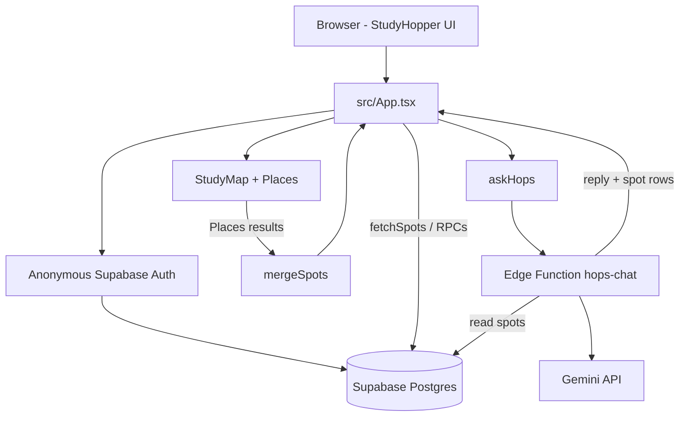

# System Architecture (as built)

StudyHopper is a **mobile-first web app**: React + Vite + TypeScript. It is **not** the original Firebase / Next.js plan, and the repo no longer ships an Expo/`mobile/` app.

## Tech stack

| Layer | What’s in the repo |
| --- | --- |
| **UI** | React 19, Vite 8, TypeScript, Tailwind CSS 4 (`@tailwindcss/vite`) |
| **Shell** | Figma Make–driven UI in `src/App.tsx` (+ `src/index.css`); hand-written integrations under `src/lib/` and `src/components/` |
| **Backend** | **Supabase** — Auth (anonymous guests), Postgres (`spots` + RPCs), Edge Function `hops-chat` |
| **Maps / places** | Google Maps JS via `@vis.gl/react-google-maps`; Google Places API (New) in `src/lib/places.ts` |
| **AI** | **Hops** (study-buddy bunny) → Supabase Edge Function → **Gemini** (`GEMINI_API_KEY`) |

**Not used in this codebase:** Firebase, Next.js, Expo / React Native, OpenAI/Grok at runtime, Spotify API.

## Repo layout

```
src/
  App.tsx                 # Main screens (map, friends, rate, log, Hops chat, …)
  main.tsx                # Vite entry
  index.css               # Global / Figma styles
  components/
    StudyMap.tsx          # Google Map + Places load; hand-drawn fallback
    CommunityLeaderboard.tsx
    DisplayNamePrompt.tsx
  lib/
    supabase.ts           # Client from VITE_SUPABASE_* (null if unset)
    auth.ts               # Anonymous guest session + display name
    db.ts                 # spots fetch/merge, ratings, sessions, leaderboard RPCs
    places.ts             # Nearby / text search → PlaceSpot
    hopsChat.ts           # invoke("hops-chat")
supabase/
  functions/hops-chat/    # Edge Function (Gemini + spots catalog)
```

Planning docs (`PLANNING.md`, `docs/`) may still mention older ideas; this file describes **running code**.

## Runtime configuration

Client (Vite env):

* `VITE_SUPABASE_URL`
* `VITE_SUPABASE_PUBLISHABLE_KEY`
* `VITE_GOOGLE_MAPS_API_KEY`

Edge Function secrets (Supabase project):

* `GEMINI_API_KEY` (required for Hops)
* `GEMINI_MODEL` (optional; function has model fallbacks)

If Supabase or Maps keys are missing, the UI still loads with **sample spots** and a **hand-drawn map**; community sync / Hops show friendly “unavailable” notices.

## Data flow



### Spots on the map

1. **Hardcoded samples** in `App.tsx` seed the first paint.
2. With a Maps key, `StudyMap` loads **nearby cafes/libraries** (UW Seattle default center).
3. When guest auth is ready, `fetchSpots()` loads community rows from `public.spots`.
4. `mergeSpots(places, community)` prefers community ratings/noise/outlets/wifi/summary when `place_id` matches; unmatched community spots still appear.

### Ratings & new cafes

* Existing community spot (`dbId`) → RPC `add_rating`.
* Google Place without a DB row → RPC `add_ranked_cafe` (creates/links spot + rating).
* Without Supabase session: kept on-device only; user sees a sync notice.

### Study sessions & friends

* Log hours → RPC `log_study_session`.
* Friends page mixes **local friend seed data** in `App.tsx` with live **`get_recent_study_sessions`** and **`get_study_leaderboard`** when Supabase is up.
* First write can prompt for a **display name** (`DisplayNamePrompt` → Auth user metadata).

### Hops chat

1. Client: `askHops` → `supabase.functions.invoke("hops-chat")` (needs guest session).
2. Function loads known spots from Postgres, calls Gemini with a short system prompt, returns `{ reply, spots }` (validated spot rows, ≤3).

## Stubbed / degraded vs fully wired

| Feature | Behavior |
| --- | --- |
| Google Map + Places | Real when `VITE_GOOGLE_MAPS_API_KEY` works; else hand-drawn map + samples |
| Supabase spots / ratings / sessions / leaderboard | Real when URL+key + anonymous auth work; else local samples / local-only saves |
| Hops AI | Real Gemini via Edge Function when configured; else chat errors with a friendly message |
| Friend activity | UI real; some friend cards are **seed data**; sessions/leaderboard can be live |
| Schema SQL in git | **Not checked in** — only `supabase/functions/hops-chat`. Tables/RPCs are implied by `src/lib/db.ts` (`spots`, `add_rating`, `add_ranked_cafe`, `log_study_session`, `get_study_leaderboard`, `get_recent_study_sessions`) |

## Local development

```bash
npm install
npm run dev    # Vite
```

Set the `VITE_*` vars in `.env.local` (gitignored). Deploy/configure the `hops-chat` function and Gemini secret in the Supabase project for live AI.

## Intentional gaps vs early plan

* **Firebase** — abandoned; Supabase is the backend.
* **Next.js / Expo** — not in this tree; product is the Vite web app.
* **Spotify / live GPS** — not implemented (friend feed uses check-in style data + seeds).
* **OpenAI / Grok as app AI** — not used; production path is Gemini through `hops-chat`.
