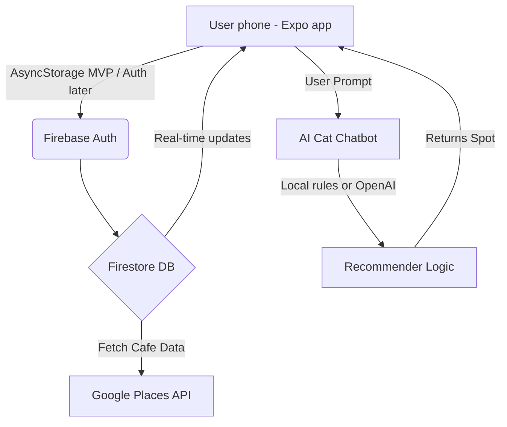

# System Architecture

## Tech Stack
*   **Mobile app (primary):** Expo (React Native) — iOS / Android via Expo Go or native builds.
*   **Backend & Realtime DB:** Firebase (Firestore + Auth) — *planned for real-time friend activity sync.*
*   **AI:** On-device recommender for demos; optional OpenAI for richer cat replies.
*   **Maps:** `react-native-maps` on device; OpenStreetMap tiles for web preview embeds.
*   **APIs (planned):** Google Places (live cafe data), Spotify Web API (stretch).

## Data Flow

## Repo layout
*   `mobile/` — Catfe Expo app (ship this)
*   `web/` — archived Next.js prototype (not primary)
*   `docs/`, `design/`, `PLANNING.md` — product planning
